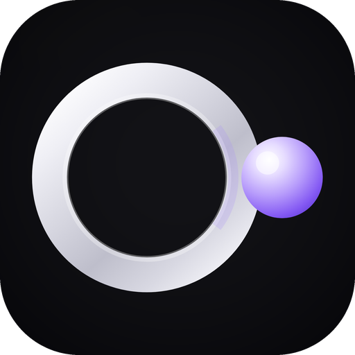
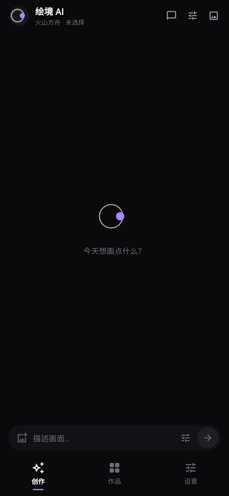
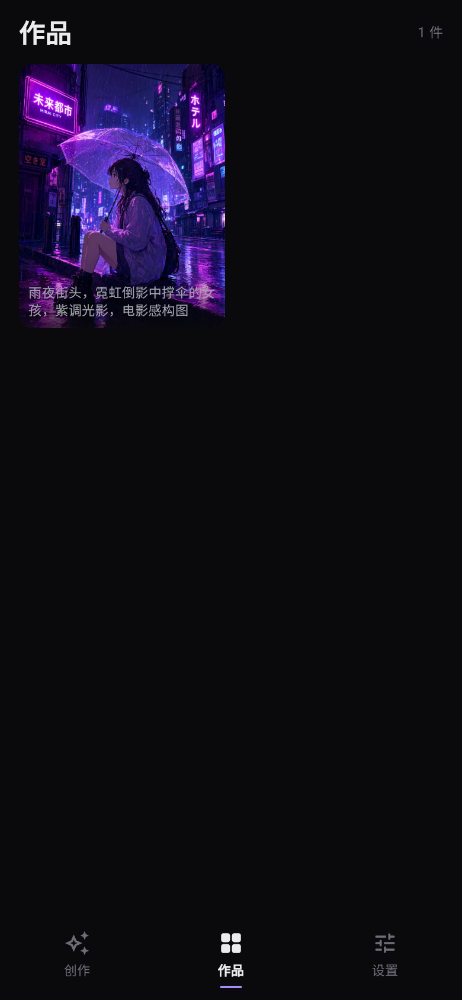

<p align="center">
  
</p>

<h1 align="center">绘境 AI</h1>

<p align="center">
  多服务商 AI 生图客户端 · 一套 Flutter 代码跑通全平台
</p>

<p align="center">
  <a href="https://github.com/MiracleBreeze/huijing-ai/releases/latest"></a>
  <a href="https://flutter.dev"></a>
  
</p>

---

**绘境 AI** 是一个深色风、沉浸式的 AI 图像创作应用。接入火山方舟、OpenAI 官方、任意 OpenAI 兼容网关与 Pollinations 免费通道，支持 8 种画幅、1K–4K 分辨率、单次最多 10 张，内置提示词润色与灵感生成。

产品以 **轻量 + 现代化** 为设计原则。

## 设计原则

**轻量**

- 纯 Flutter 原生渲染，不使用嵌入浏览器或重型容器
- 零状态管理框架，`ChangeNotifier` 单例直连页面，依赖少、启动快
- 无广告、无统计、无后台常驻；数据只存本机 `shared_preferences`
- 图标、Logo、面板全部自绘或使用系统组件，不引入大体积资源包

**现代化**

- Material 3 深色设计体系：统一色板、圆角、字阶与组件主题
- 自绘 24 网格图标系统（`hj_icons.dart`），1.75 描边、圆头圆角，与品牌几何一致
- 可上下拖动的 `DraggableScrollableSheet` 面板、沉浸画布、全屏看图等现代交互
- 一套代码适配手机、平板与桌面窗口，Android / iOS / Web / Windows / macOS / Linux 同源

## 预览

<p align="center">
  
  
  
  
</p>

## 特性

| | |
| --- | --- |
| **四服务商** | 方舟 Seedream · OpenAI 官方 · OpenAI 兼容网关 · Pollinations 免 Key |
| **模型实时拉取** | 统一走 `/models`，不内置写死模型，换网关不留旧名 |
| **画幅 8 × 清晰度 3** | 1:1 / 4:3 / 3:4 / 16:9 / 9:16 / 3:2 / 2:3 / 21:9，1K / 2K / 4K，1–10 张 |
| **双创作模式** | 沉浸画布左右滑动 · 对话流 + 多图内联操作 |
| **全屏看图** | 模糊底 + 悬浮操作栏 + 提示词胶囊一键复制 |
| **可拖动面板** | 参数 / 模型 / AI 助手，上下拖动调整高度，下拖关闭 |
| **AI 助手** | 润色四档 + 一次 3 条灵感，接口不可用时本地兜底 |
| **本地优先** | 设置 / 作品 / 对话本地持久化，Key 不上传 |

## 下载

**Android 7.0+** · 前往 [Releases](https://github.com/MiracleBreeze/huijing-ai/releases/latest) 下载最新 APK。

其他平台使用同一份源码构建：

| 平台 | 命令 | 说明 |
| --- | --- | --- |
| Android | `flutter build apk --release` | 已提供通用 APK（arm64 / armv7 / x86_64） |
| iOS | `flutter build ipa` | macOS + Xcode 签名 |
| Web | `flutter build web --release` | 构建已验证 |
| Windows | `flutter build windows` | Visual Studio C++ 工具链 |
| macOS | `flutter build macos` | Xcode |
| Linux | `flutter build linux` | GTK 3 开发库 |

## 快速开始

```bash
flutter pub get
flutter run
```

首次使用：进入「设置」→ 选服务商 → 填接口地址与 API Key（免费通道可跳过）→ 拉取模型 → 回到「创作」输入提示词。

## 构建

```bash
flutter build apk --release --build-name=1.9.11 --build-number=10911
# → build/app/outputs/flutter-apk/app-release.apk
```

环境：Flutter 3.50.1（Dart 3.14）、Android SDK 36、JDK 17+。

## 结构

<details>
<summary>展开目录</summary>

```text
lib/
  main.dart            入口 / 主题 / 系统栏
  app.dart             全局 AppState 单例
  theme.dart           设计 token + Material 3 主题
  models.dart          Work / ChatMsg / AppSettings / 尺寸换算
  data/providers.dart  四服务商定义
  services/            api · store · assistant · media
  widgets/             logo · hj_icons · ui · sheets
  screens/             home · create · viewer · gallery · settings
test/                  UI 回归测试 × 4
```
</details>

## 技术栈

`Flutter 3.50` · `Dart 3.14` · Material 3 · `http` · `shared_preferences` · `image_picker` · `gal` · `share_plus`

## 说明

- 图片以 data URI 存入 `shared_preferences`，作品多时体积偏大，后续可换文件缓存。
- Release APK 沿用工程默认 debug 签名，上架商店前请替换正式签名。
- API Key 仅保存在本机，请求直连你配置的服务商。

<p align="center"><sub>v1.9.11 · Android versionCode 10911</sub></p>