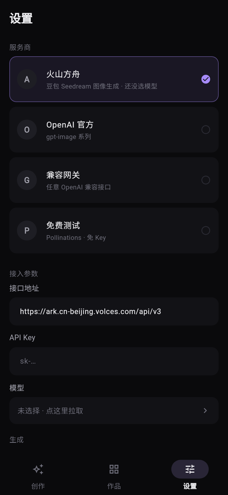

# 绘境 AI · HuiJing AI

[](https://github.com/MiracleBreeze/huijing-ai/releases/latest)
[](https://flutter.dev)
[](https://github.com/MiracleBreeze/huijing-ai)

> 跨平台 AI 生图客户端，一套 Flutter 代码构建 Android / iOS / Web / Windows / macOS / Linux。

绘境 AI 是一个轻量的 AI 图像创作应用：接入火山方舟、OpenAI 官方、任意 OpenAI 兼容网关或 Pollinations 免费通道，支持 8 种画幅、1K/2K/4K 分辨率、一次生成最多 10 张，并提供沉浸画布与对话两种创作模式、全屏看图、AI 提示词润色与灵感生成。界面全部使用 Flutter 原生组件构建（`AppBar`、`NavigationBar`、`ListTile`、`SegmentedButton`、`ChoiceChip`、`DropdownMenu`、`FilledButton`、`DraggableScrollableSheet`），跨端表现一致。

## 下载

- **Android**：前往 [Releases](https://github.com/MiracleBreeze/huijing-ai/releases/latest) 下载 `huijing-ai-v1.9.4.apk`（Android 7.0+）
- **其他平台**：同一份源码直接构建，命令见下方「构建」

## 全平台支持

| 平台 | 支持情况 | 说明 |
| --- | --- | --- |
| Android | ✅ 提供安装包 | minSdk 24 / targetSdk 36，通用 APK 含 arm64-v8a、armeabi-v7a、x86_64 |
| iOS | ✅ 工程完整 | 需 macOS + Xcode 签名，`flutter build ipa` |
| Web | ✅ 已验证构建 | `flutter build web --release`，Chrome / Edge / Safari 均可运行 |
| Windows | ✅ 工程完整 | `flutter build windows`，需 Visual Studio C++ 工具链 |
| macOS | ✅ 工程完整 | `flutter build macos`，需 Xcode |
| Linux | ✅ 工程完整 | `flutter build linux`，需 GTK 3 开发库 |

界面采用响应式布局，手机、平板与桌面窗口自适应；系统返回键、状态栏、导航栏样式按平台处理。

## 截图

<table>
  <tr>
    <td align="center"><br /><sub>创作 · 沉浸画布</sub></td>
    <td align="center"><br /><sub>作品 · 本地作品库</sub></td>
  </tr>
  <tr>
    <td align="center"><br /><sub>全屏看图 · 悬浮操作</sub></td>
    <td align="center"><br /><sub>设置 · 服务商与模型</sub></td>
  </tr>
</table>

## 功能

**四类服务商，全部可切换**

| 服务商 | 协议 | 默认地址 | 说明 |
| --- | --- | --- | --- |
| 火山方舟 | Ark | `https://ark.cn-beijing.volces.com/api/v3` | 豆包 Seedream 图像生成 |
| OpenAI 官方 | OpenAI | `https://api.openai.com/v1` | gpt-image 系列 |
| 兼容网关 | OpenAI | 自填 | 任意 OpenAI 兼容接口（one-api、new-api 等） |
| 免费测试 | Pollinations | `https://image.pollinations.ai` | 免 Key 试用通道 |

- **模型只认接口**：不内置写死的模型列表，必须通过 `/models` 实时拉取后再选择，换网关不会拿到过期模型名。
- **画幅 8 项 × 清晰度 3 档**：1:1 / 4:3 / 3:4 / 16:9 / 9:16 / 3:2 / 2:3 / 21:9，1K 预览 / 2K 推荐 / 4K 超清，宽高自动对齐 8 的倍数；数量 1–10 用下拉竖列选择。
- **两种创作模式**：沉浸画布居中完整显示、左右滑动切换；对话模式为消息流 + 多图平铺，图片下方提供保存 / 重新编辑 / 再次生成 / 分享四个内联操作。
- **全屏看图**：同图模糊压暗作背景、原图 contain 居中；右侧悬浮四个圆形按钮；底部提示词胶囊点一下复制；多点指示 + 左右滑动。
- **可拖动面板**：参数面板、模型面板、AI 助手面板基于 `DraggableScrollableSheet`，上下拖动改变高度，向下拖过界关闭。
- **AI 助手**：提示词润色四档（只修格式 / 更精简 / 更深入 / 更有张力）与生成灵感（一次 3 条）；接口不可用时自动回落到本地规则。
- **本地作品库**：设置、作品（最多 30 件）、对话（最多 60 条）持久化在 `shared_preferences`；支持保存到相册、系统分享、相册选取参考图。
- **品牌图标**：Android 五档 mipmap + adaptive icon（前景透明 + 深色底），iOS / Web 图标同步；应用内使用 `LogoMark`（环 + 光点）绘制品牌标志。
- **水印开关**：方舟接口支持关闭 AI 生成水印。

## 快速开始

环境要求：

- Flutter 3.50.1（Dart 3.14）
- Android 构建需要 Android SDK 36、JDK 17+
- iOS / macOS 构建需要 macOS + Xcode

```bash
flutter pub get
flutter run                     # 当前平台调试
flutter test                    # 运行测试
```

构建发布包：

```bash
flutter build apk --release --build-name=1.9.4 --build-number=10904
# 产物：build/app/outputs/flutter-apk/app-release.apk

flutter build appbundle --release   # Google Play AAB
flutter build ipa                   # iOS（需 macOS）
flutter build web --release         # Web
flutter build windows               # Windows
flutter build macos                 # macOS
flutter build linux                 # Linux
```

## 使用

1. 打开 App，进入「设置」。
2. 选择服务商，填写接口地址与 API Key（免费测试通道无需 Key）。
3. 点「拉取模型」，从 `/models` 返回值中选择一个模型。
4. 回到「创作」，输入提示词，通过底部参数条调整画幅、清晰度与数量，发送即可。

> 兼容网关如果是自建的 HTTP 地址，请改用 HTTPS 或配置 Android 明文流量白名单（Android 9+ 默认禁止明文 HTTP）。

## 项目结构

```
lib/
  main.dart             入口、主题、系统状态栏
  app.dart              全局 AppState 单例
  theme.dart            设计 token + Material 3 组件主题
  models.dart           Work / ChatMsg / AppSettings / 比例与尺寸换算
  data/providers.dart   四服务商定义
  services/
    api.dart            生图、/models 实时拉取、对话接口
    store.dart          本地持久化 + 生成状态 + 本地润色/灵感兜底
    assistant.dart      润色四档提示词、灵感提示词
    media.dart          相册保存、系统分享、参考图选取
  widgets/
    logo.dart           品牌标志 LogoMark（环 + 光点）
    ui.dart             图片渲染、IconBtn、Pill、可上下拖动的 showAppSheet
    sheets.dart         参数面板 / 模型面板 / AI 助手面板
  screens/
    home.dart           AppBar + 底部导航（创作 / 作品 / 设置）+ 生成中遮罩
    create_page.dart    沉浸画布 / 对话列表 / 输入条 / 参考图
    viewer_page.dart    全屏看图：模糊底 + 四悬浮按钮 + 提示词胶囊
    gallery_page.dart   作品网格（长按删除）
    settings_page.dart  服务商、接口地址、Key、模型、水印、备份、清空
test/
  app_test.dart         首页三栏、服务商点选、数量下拉、看图页四按钮
```

## 技术栈

- Flutter 3.50.1 / Dart 3.14，Material 3，零状态管理框架（`ChangeNotifier` 单例）
- `http` 网络请求，`shared_preferences` 本地存储
- `image_picker` 选取参考图，`gal` 保存相册，`share_plus` 系统分享

## 已知限制

- 图片以 data URI 形式存进 `shared_preferences`，作品多时体积偏大，后续可改为文件缓存 + 缩略图。
- 仓库内 Android Release 构建沿用工程默认的 debug 签名，正式上架商店前请替换为自己的签名配置。
- iOS / Windows / macOS / Linux 平台目录由 `flutter create` 生成并保持完整，未逐平台预置商店签名与图标微调。

## 隐私

API Key 仅保存在设备本地的 `shared_preferences` 中，不会上传到任何第三方服务器；所有请求直接发往你配置的服务商接口。

## 版本

当前版本：**v1.9.4**（Android versionName 1.9.4 / versionCode 10904）